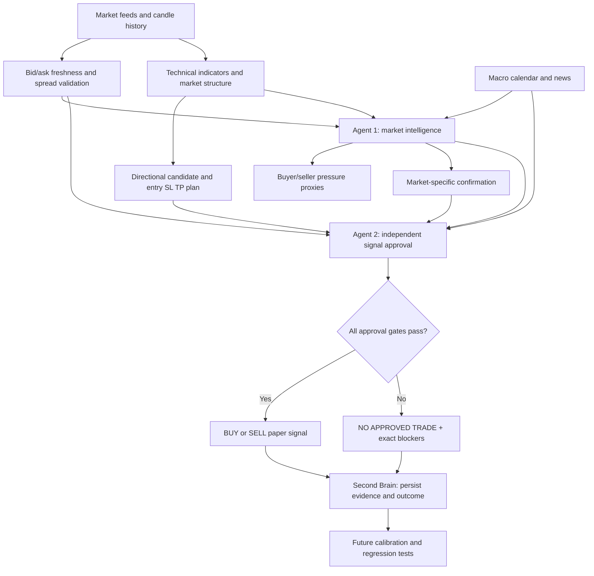

# Forex Sniper — EUR/USD + BTC/USD + XAU/USD

A Node.js market-analysis and paper-signal project for EUR/USD, BTC/USD and XAU/USD. It analyses closed M5, M15, H1 and H4 candles and prints a separate report for each market.

## What it does

- Downloads historical candles from Dukascopy using dukascopy-node.
- Calculates EMA, RSI, MACD, ATR, volume profile (POC/VAH/VAL), market structure and squeeze momentum.
- Tracks London, New York, Tokyo and Sydney sessions and session ranges.
- Uses BTC options positioning as supplemental context only.
- Evaluates each market independently and produces an ATR-based entry, stop-loss and take-profit only when setup and confirmation align.

Safety: this project is analysis-only. It does not connect to Vantage or place live orders. A BUY/SELL output is not a guarantee of profitability. Validate performance with realistic spreads, commissions, slippage and out-of-sample testing before risking money.

## Economic calendar status

The automated economic calendar uses the public, no-key ShowMyTrades calendar endpoint:
https://showmytrades.com/api/public/calendar/v1

The integration requests EUR and USD high/medium-impact events for a seven-day window. It validates the provider's documented JSON schema, event count, UTC server clock, generated-at freshness, coverage window, each event's Unix/ISO timestamp agreement, currency, impact, status and confidence. The provider documents a 15-minute response cache and recommends polling every 15 minutes; the five-minute signal workflow may therefore receive the same cached calendar several times.

Only events with an unambiguous schedule (official or sources_agree) are assigned a precise release time. Tentative, conflicting-source or single-source high-impact events have their time treated as unverified; if one is scheduled for today, the affected market remains blocked for the day. Missing, stale, malformed, clock-inconsistent or insufficient-coverage responses remain UNKNOWN and block new entries. A valid zero-event response is accepted only when its clock, count and coverage checks pass.

Market mapping: EUR/USD watches EUR and USD events; BTC/USD and XAU/USD watch USD events. The configured protection window is 15 minutes before and after high-impact releases and 5 minutes before and after medium-impact releases. This is a conservative timing filter, not a forecast of price direction. The feed is an aggregated third-party schedule, not an official government source; unexpected announcements and provider mistakes remain possible.

Credit: [Economic calendar by ShowMyTrades](https://showmytrades.com/tools/economic-calendar). Provider documentation: https://showmytrades.com/docs/api/economic-calendar. Forex Factory remains a manual secondary reference only: https://www.forexfactory.com/calendar; the project does not scrape it.

Headline news remains supplemental and cannot override the calendar gate. A clear calendar window is only one risk check; it does not by itself authorize a BUY/SELL signal or broker order.

## Multi-agent decision layer

The local decision panel now contains 11 technical specialists plus six independent quantitative forecasting agents. The forecast agents use closed M5 candle history and estimate the next three candles with:
- Exponentially weighted least-squares trend projection and residual statistics.
- AR(1) conditional-return autoregression.
- A two-state local-linear-trend Kalman filter.
- EWMA volatility-adjusted momentum.
- Autocorrelation-based dominant-cycle and harmonic projection.
- Nearest-neighbour historical pattern outcomes.

Each forecaster reports BUY, SELL or HOLD, an estimated probability of an upward move, expected movement in ATR units and supporting evidence. These are estimates, not certainty. In the current weighted decision path, forecaster consensus and the optional six-role Gemini review are supplemental diagnostics, not additional mandatory AND-gates; neither can approve a trade by itself. Independent market-intelligence review, weighted evidence, quote/spread validation, the M5 trigger, calendar/news risk, live-quote reward/risk and the risk manager remain the paper-approval controls.

An optional model outage cannot by itself manufacture an approval or rejection. A technical HOLD cannot be promoted into an approved trade.

## Immediate directional candidate output

As soon as closed M5/M15/H1/H4 candle analysis, the reference bid/ask check and deterministic weighted scoring are available, the run prints an **EARLY DIRECTIONAL CANDIDATE — RESEARCH ONLY** snapshot. It includes the market, BUY/SELL/NO SETUP direction, weighted score and evidence coverage, generation time, latest closed M5 timestamp, M5 close, available bid/ask and quote source, quote-validation state, and hard blockers. This output is emitted before the independent signal-approval and entry-verification agents finish, so a user can see the market's current directional hypothesis without waiting for the entire review chain.

The directional candidate remains visible with a separate grade. **Grade A** means a complete paper signal passed every approval gate; it is still not a broker order. **Grade B** means a BUY/SELL direction exists but one or more gates failed, so any complete quote-priced levels are explicitly indicative and **not approved**. If no fresh provider-timestamped quote or valid plan exists, entry/SL/TP remain unavailable rather than being invented. **NO SETUP** means no BUY/SELL direction was discovered. Candidate strength is never a probability of profit. Calendar or data uncertainty can therefore leave a visible Grade B research candidate while still blocking Grade A approval.

## Two-agent decision engine

Every market run uses three independent local decision agents:

1. **Market Intelligence Agent** — EUR/USD uses M15/H1/H4 directional majority plus a closed M5 trigger and spread/ATR review; BTC/USD checks H1 squeeze state, release and signed momentum; Gold checks event timing and headline risk.
2. **Signal Approval Agent** — checks candidate direction, market-agent approval, entry/stop/target geometry, minimum 1:2 risk/reward, closed M5 trigger, fresh bid/ask validation and data/risk blockers.
3. **Live Entry Verification Agent** — rechecks the current executable-side bid (SELL) or ask (BUY), quote age, spread/ATR, anti-chasing distance and effective live-quote reward/risk immediately before paper approval.

The buyer/seller panel uses candle close location, CVD, OBV and MFI as *pressure proxies*. A best bid/ask quote is not full order-book depth, and candle/tick volume is not consolidated executed buy/sell volume. The system labels those limitations rather than inventing order-flow data. Both agent decisions, order-flow evidence and rejection reasons are stored in the persistent Second Brain for later review.

An approved BUY/SELL is a **paper research signal only**. The current providers are reference market-data feeds and no verified brokerage account/order route is connected, so the engine never claims that these prices are broker-executable and never places live orders. When gates fail, the final result is NO APPROVED TRADE.

### Signal-engine decision graph



## Persistent Second Brain

The signal engine records an append-only research journal at `data/second-brain.jsonl`. Each market snapshot stores VWAP strategy votes, deterministic-agent votes, independent LLM review status, event-risk state and M5/M15/H1/H4 context. Executable paper BUY/SELL plans are tracked against later closed M5 candles; target hits are labelled wins, stop hits losses, and same-candle stop/target touches ambiguous rather than guessing the order. It reports observed outcomes, not a promise of future accuracy. The live refresh workflow commits this journal so it survives scheduled runs. No live orders are placed.

## Requirements

- Node.js 20+
- npm
- Optional GEMINI_API_KEY for the six-role cloud review
- Biquote public REST feed for EUR/USD and XAU/USD bid/ask quotes (no API key required)
- Coinbase Exchange public ticker REST endpoint for BTC/USD bid/ask quotes (no API key required)
- Optional TWELVE_DATA_API_KEY as a secondary bid/ask fallback where the provider supplies both sides

## Setup

```bash
npm install
npm run check
npm test
```

## Automatic operation

The repository uses one primary multi-market pipeline to avoid duplicate scheduled jobs:

- **Every 5 minutes (target):** Forex Sniper Live Candle Refresh downloads EUR/USD, BTC/USD and XAU/USD M5/M15/H1/H4 data, runs mandatory syntax and regression tests, generates the three-market signal report, verifies all three independent review agents and fresh bid/ask quotes, validates closed candles, then publishes the dashboard snapshot and Second Brain journal.
- **Every 15 minutes:** BTCUSD Branch Live Refresh independently refreshes the BTC branch as a secondary diagnostic feed.
- **Daily at 15:00 UTC:** Gold-specific validation and backtests.
- **Weekly Sunday at 02:00 UTC:** Multi-market strategy and chronological holdout backtests.
- **Every 5 minutes:** Actions Queue Watchdog checks stale queued test workflows. It only cancels a run after it has been queued for at least 60 seconds and still has no jobs; it dispatches at most one replacement check and enforces a 15-minute cooldown.
- **On pushes and pull requests:** syntax, regression, provider and quant validation workflows run automatically.
- The older Automatic Signals and Scheduled Multi-Market Snapshot workflows remain available for manual diagnostics and no longer compete with the primary schedule.

GitHub Actions is polling, not continuous streaming. The five-minute cadence is a target, not a guarantee; GitHub may delay scheduled runs. Quote freshness is measured from each quote's provider timestamp at the decision point, not from the scheduled workflow start time. BTC/USD historical candles use Kraken spot OHLC while the live quote uses Coinbase Exchange; EUR/USD and XAU/USD quote entries use Biquote's aggregated MT5 feed. Twelve Data is a secondary fallback only when it supplies a complete provider-timestamped bid/ask pair. These are reference feeds, not a connected brokerage execution venue. The scheduled signal pipeline does not depend on Railway.

The primary pipeline stops before signal publication when tests fail, any market is missing from the report, the independent agent review is incomplete, a bid/ask quote is stale/invalid, or the closed-candle dashboard snapshot fails validation. The latest output is available under Actions → Forex Sniper Live Candle Refresh → latest run → Artifacts.

**Economic-calendar safety:** the ShowMyTrades structured feed is now integrated with schema, clock, freshness, coverage and event-confidence checks. If any validation fails, event risk stays UNKNOWN and new entries remain blocked. The provider is third-party and is not an official agency feed; automation does not bypass the fail-closed checks. No live orders are placed.

## Tests

```bash
npm run check
npm test
```

A HOLD / NO TRADE result remains correct when confirmation or risk checks fail. No profile guarantees profitability.

## Quant Swarm dashboard

The browser dashboard is available in dashboard/. Its supplemental BTC quant view uses public market-data streams. Deterministic votes are indicators, not proof of profitability. Paper trading only; no live orders, wallet connection, deposits or withdrawals are supported.


## Investing.com secondary reference

The dashboard includes manual links to Investing.com for EUR/USD, Bitcoin and gold as an independent visual cross-check. This is not an automated data feed: Investing.com states it does not offer a public API. The project does not scrape its pages or feed displayed quotes into agent calculations. A reviewer should compare the same instrument, quote type and timestamp; any discrepancy is a data-quality warning only. Existing validated candle providers remain the engine's source of market data. Do not use this reference panel to override candle freshness, economic-calendar, consensus or risk gates.


## Optional 24/7 quote monitor

The legacy Railway-hosted quote monitor may still be deployed separately for diagnostics, but it is not a dependency of the GitHub signal workflow. The scheduled analysis obtains market quotes directly from Biquote (EUR/USD and XAU/USD) and Coinbase Exchange (BTC/USD), with Twelve Data as a validated fallback. The workflow does not set `REALTIME_FEED_URL`. The signal engine still fails closed when no fresh provider-timestamped quote is available.

## Manual execution mode (user executes)

Forex Sniper is configured for **manual execution by the user**. No broker connection, API trading key, wallet, or automatic order-placement adapter is required or enabled.

- The engine's job is to monitor reference market data, analyse the three markets, verify candidates and publish a paper/research trade plan.
- When every hard gate passes, the report may publish an approved **BUY** or **SELL** plan with direction, reference entry, stop-loss, take-profit, risk/reward, quote source and timestamp.
- When any required check fails, data is stale, or independent approval is missing, the final result must remain **NO APPROVED TRADE**. A directional candidate must never be presented as an approved trade.
- The user independently checks the current price, spread, instrument/contract specification and execution conditions at their chosen platform, then decides whether to place the order.
- The user's actual fill can differ from the reference entry because of broker pricing, spread, latency, slippage and market movement. The published levels are planning references, not guaranteed fills.
- No order is sent by Forex Sniper. The system must not imply that a trade was executed or that a broker position exists.
- Keep all existing signal, quote-freshness, calendar, entry-confirmation and risk gates unchanged. Manual execution is not permission to bypass a rejected signal or force a BUY/SELL.

This is the intended operating mode until the user explicitly requests and separately configures a broker integration.
