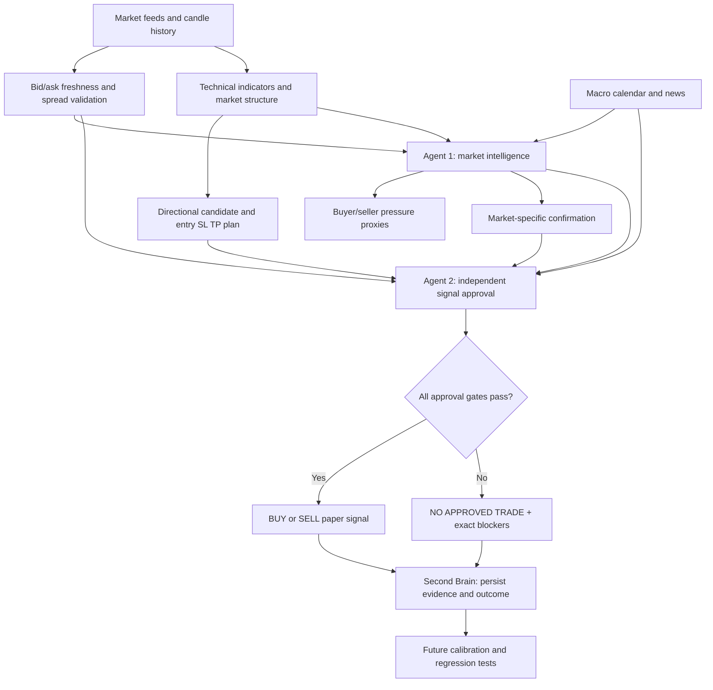

# Forex Sniper — EUR/USD + BTC/USD + XAU/USD

A Node.js market-analysis and paper-signal project for EUR/USD, BTC/USD and XAU/USD. It analyses closed M5, M15, H1 and H4 candles and prints a separate report for each market.

## What it does

- Downloads historical candles from Dukascopy using dukascopy-node.
- Calculates EMA, RSI, MACD, ATR, volume profile (POC/VAH/VAL), market structure and squeeze momentum.
- Tracks London, New York, Tokyo and Sydney sessions and session ranges.
- Uses BTC options positioning as supplemental context only.
- Evaluates each market independently and produces an ATR-based entry, stop-loss and take-profit only when setup and confirmation align.

Safety: this project is analysis-only. It does not connect to Vantage or place live orders. A BUY/SELL output is not a guarantee of profitability. Validate performance with realistic spreads, commissions, slippage and out-of-sample testing before risking money.

## Economic calendar status

The Finance Calendar API integration and FINANCE_CALENDAR_API_KEY dependency have been removed because the provider rejected the configured key with HTTP 401.

Forex Factory remains a manual reference only: https://www.forexfactory.com/calendar. The project does not scrape, copy or redistribute its schedule. There is currently no automated structured economic-calendar provider.

Important safety behavior: with no verified automated calendar, event risk is UNKNOWN and the execution engine keeps new entries blocked (HOLD). Headline news is context only and does not replace a scheduled-event calendar. Do not interpret technical directional bias as permission to trade. A future provider must pass authentication, freshness, coverage, pagination and event-normalization checks before it can clear the calendar gate.

## Multi-agent decision layer

The local decision panel now contains 11 technical specialists plus six independent quantitative forecasting agents. The forecast agents use closed M5 candle history and estimate the next three candles with:
- Exponentially weighted least-squares trend projection and residual statistics.
- AR(1) conditional-return autoregression.
- A two-state local-linear-trend Kalman filter.
- EWMA volatility-adjusted momentum.
- Autocorrelation-based dominant-cycle and harmonic projection.
- Nearest-neighbour historical pattern outcomes.

Each forecaster reports BUY, SELL or HOLD, estimated probability of an upward move, expected movement in ATR units and its evidence. Forecasts are estimates, not certainty. A GOOD confirmation requires at least four of the six forecast agents to agree, in addition to the existing technical consensus, higher-timeframe alignment, volatility agreement and risk approval. The optional six-role Gemini review remains an independent veto-only check.

These agents cannot override stale candle checks, calendar risk, entry validation or portfolio risk controls. A technical HOLD cannot be promoted into a trade.

## Two-agent decision engine

Every market run now uses two independent local agents connected in sequence:

1. **Market Intelligence Agent** — EUR/USD uses M15/H1/H4 directional majority plus a closed M5 trigger and spread/ATR review; BTC/USD checks H1 squeeze state, release and signed momentum before accepting the direction; Gold separates active high-impact releases, upcoming events inside the 30-minute pre-release lock, more distant upcoming events and recent headline caution.
2. **Signal Approval Agent** — independently checks candidate direction, market-agent approval, entry/stop/target geometry, minimum 1:2 risk/reward, closed M5 trigger, fresh bid/ask validation and all data/risk blockers. It records the exact reasons for rejection.

The buyer/seller panel uses candle close location, CVD, OBV and MFI as *pressure proxies*. A best bid/ask quote is not full order-book depth, and candle/tick volume is not consolidated executed buy/sell volume. The system labels those limitations rather than inventing order-flow data. Both agent decisions, order-flow evidence and rejection reasons are stored in the persistent Second Brain for later review.

An approved BUY/SELL is a **paper research signal only**. The current providers are reference market-data feeds and no verified brokerage account/order route is connected, so the engine never claims that these prices are broker-executable and never places live orders. When gates fail, the final result is NO APPROVED TRADE.

### Signal-engine decision graph



## Persistent Second Brain

The signal engine records an append-only research journal at `data/second-brain.jsonl`. Each market snapshot stores VWAP strategy votes, deterministic-agent votes, independent LLM review status, event-risk state and M5/M15/H1/H4 context. Executable paper BUY/SELL plans are tracked against later closed M5 candles; target hits are labelled wins, stop hits losses, and same-candle stop/target touches ambiguous rather than guessing the order. It reports observed outcomes, not a promise of future accuracy. The live refresh workflow commits this journal so it survives scheduled runs. No live orders are placed.

## Requirements

- Node.js 20+
- npm
- Optional GEMINI_API_KEY for the six-role cloud review
- Biquote public REST feed for EUR/USD and XAU/USD bid/ask quotes (no API key required)
- Kraken public ticker for BTC/USD bid/ask quotes (no API key required)
- Optional TWELVE_DATA_API_KEY as a secondary bid/ask fallback where the provider supplies both sides

## Setup

```bash
npm install
npm run check
npm test
```

## Automatic operation

The repository uses one primary multi-market pipeline to avoid duplicate scheduled jobs:

- **Every 5 minutes (target):** Forex Sniper Live Candle Refresh downloads EUR/USD, BTC/USD and XAU/USD M5/M15/H1/H4 data, runs mandatory syntax and regression tests, generates the three-market signal report, verifies all three independent review agents and fresh bid/ask quotes, validates closed candles, then publishes the dashboard snapshot and Second Brain journal.
- **Every 15 minutes:** BTCUSD Branch Live Refresh independently refreshes the BTC branch as a secondary diagnostic feed.
- **Daily at 15:00 UTC:** Gold-specific validation and backtests.
- **Weekly Sunday at 02:00 UTC:** Multi-market strategy and chronological holdout backtests.
- **Every 5 minutes:** Actions Queue Watchdog checks stale queued test workflows. It only cancels a run after it has been queued for at least 60 seconds and still has no jobs; it dispatches at most one replacement check and enforces a 15-minute cooldown.
- **On pushes and pull requests:** syntax, regression, provider and quant validation workflows run automatically.
- The older Automatic Signals and Scheduled Multi-Market Snapshot workflows remain available for manual diagnostics and no longer compete with the primary schedule.

GitHub Actions is polling, not continuous streaming. The five-minute cadence is a target, not a guarantee; GitHub may delay scheduled runs, and a watchdog also needs an available runner. BTC/USD candles and bid/ask quotes use Kraken spot reference data, not a broker CFD quote. EUR/USD and XAU/USD bid/ask use Biquote's aggregated MT5 feed, with Twelve Data as a secondary fallback. These are reference feeds, not a connected brokerage execution venue.

The primary pipeline stops before signal publication when tests fail, any market is missing from the report, the independent agent review is incomplete, a bid/ask quote is stale/invalid, or the closed-candle dashboard snapshot fails validation. The latest output is available under Actions → Forex Sniper Live Candle Refresh → latest run → Artifacts.

**Important current limitation:** there is no verified automated structured economic-calendar provider configured. The engine therefore treats scheduled-event risk as UNKNOWN and blocks new entries. Automation does not bypass that safety gate. No live orders are placed.

## Tests

```bash
npm run check
npm test
```

A HOLD / NO TRADE result remains correct when confirmation or risk checks fail. No profile guarantees profitability.

## Quant Swarm dashboard

The browser dashboard is available in dashboard/. Its supplemental BTC quant view uses public market-data streams. Deterministic votes are indicators, not proof of profitability. Paper trading only; no live orders, wallet connection, deposits or withdrawals are supported.


## Investing.com secondary reference

The dashboard includes manual links to Investing.com for EUR/USD, Bitcoin and gold as an independent visual cross-check. This is not an automated data feed: Investing.com states it does not offer a public API. The project does not scrape its pages or feed displayed quotes into agent calculations. A reviewer should compare the same instrument, quote type and timestamp; any discrepancy is a data-quality warning only. Existing validated candle providers remain the engine's source of market data. Do not use this reference panel to override candle freshness, economic-calendar, consensus or risk gates.
